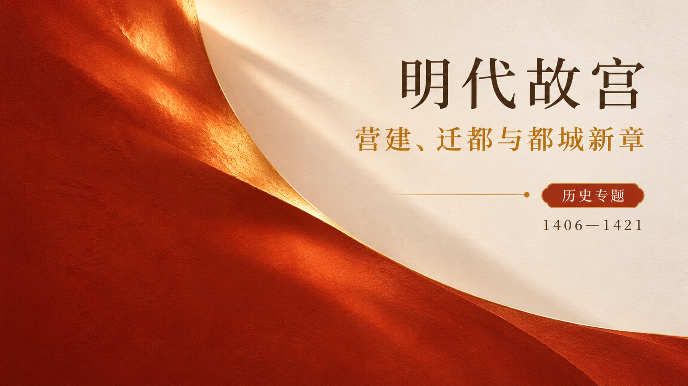
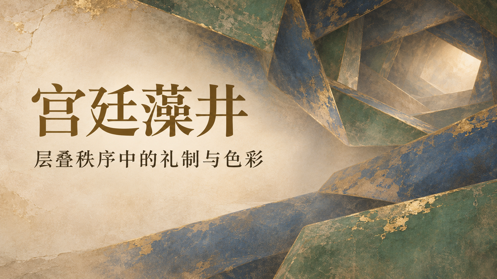
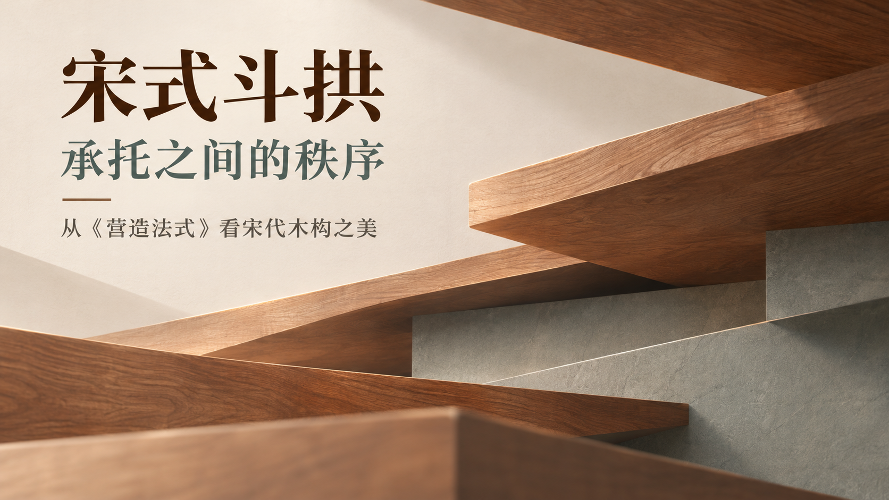
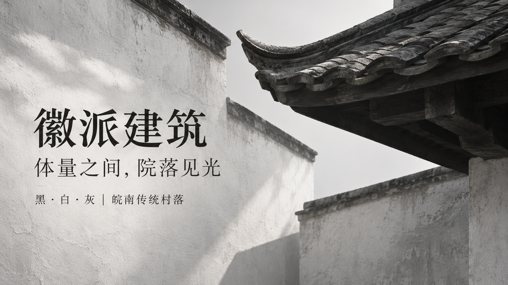
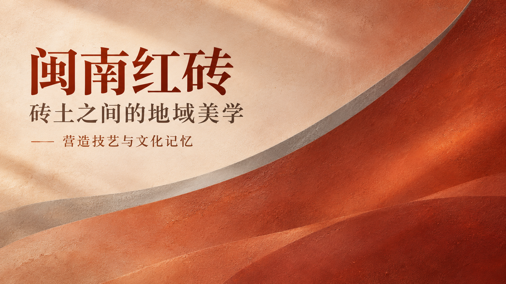

# 中华国风PPT设计技能库

**统一设计语言，不固定页面模板。**

[English edition](https://github.com/Jacky0111/chinese-aesthetic-ppt-skill-set) · 作者：Jacky0111

从中国陶瓷、古典建筑与石窟艺术中提炼色彩、材质、纹理、光泽与空间秩序，转译为内容驱动的现代演示设计。本库包含 13 个风格 Skill 与 1 个新风格导入工作流。

## 风格一览

下图是 AI 生成的现代设计示意，不是历史图像或固定模板；使用前请看 [已知问题](KNOWN-ISSUES.md)。

<table>
<tr>
<td width="33%" align="center"><a href=".agents/skills/ruyao-blue-slide-design/SKILL.md"></a><br><b>汝窑天青</b><br><code>ruyao-blue-slide-design</code></td>
<td width="33%" align="center"><a href=".agents/skills/guan-ice-crackle/SKILL.md"></a><br><b>官窑冰裂</b><br><code>guan-ice-crackle</code></td>
<td width="33%" align="center"><a href=".agents/skills/junyao-kiln-transformation/SKILL.md"></a><br><b>钧窑窑变</b><br><code>junyao-kiln-transformation</code></td>
</tr>
<tr>
<td width="33%" align="center"><a href=".agents/skills/jianzhan-yaobian/SKILL.md"></a><br><b>建盏曜变</b><br><code>jianzhan-yaobian</code></td>
<td width="33%" align="center"><a href=".agents/skills/qianlong-enamel/SKILL.md"></a><br><b>乾隆珐琅彩</b><br><code>qianlong-enamel</code></td>
<td width="33%" align="center"><a href=".agents/skills/ming-forbidden-city/SKILL.md"></a><br><b>明代故宫</b><br><code>ming-forbidden-city</code></td>
</tr>
<tr>
<td width="33%" align="center"><a href=".agents/skills/tiantan-qinian/SKILL.md"></a><br><b>天坛祈年</b><br><code>tiantan-qinian</code></td>
<td width="33%" align="center"><a href=".agents/skills/palace-caisson/SKILL.md"></a><br><b>宫廷藻井</b><br><code>palace-caisson</code></td>
<td width="33%" align="center"><a href=".agents/skills/tang-timber-architecture/SKILL.md"></a><br><b>唐代木构</b><br><code>tang-timber-architecture</code></td>
</tr>
<tr>
<td width="33%" align="center"><a href=".agents/skills/song-dougong/SKILL.md"></a><br><b>宋式斗拱</b><br><code>song-dougong</code></td>
<td width="33%" align="center"><a href=".agents/skills/huizhou-architecture/SKILL.md"></a><br><b>徽派建筑</b><br><code>huizhou-architecture</code></td>
<td width="33%" align="center"><a href=".agents/skills/dunhuang-caves/SKILL.md"></a><br><b>敦煌石窟</b><br><code>dunhuang-caves</code></td>
</tr>
<tr>
<td width="33%" align="center"><a href=".agents/skills/minnan-red-brick/SKILL.md"></a><br><b>闽南红砖</b><br><code>minnan-red-brick</code></td>
</tr>
</table>

| 稳定 ID | 风格 | 分类 | 版本 |
|---|---|---|---|
| `ruyao-blue-slide-design` | 汝窑天青 | 陶瓷 / 汝窑 | `0.1.0` |
| `guan-ice-crackle` | 官窑冰裂 | 陶瓷 / 官窑 | `0.1.0` |
| `junyao-kiln-transformation` | 钧窑窑变 | 陶瓷 / 钧窑 | `0.1.0` |
| `jianzhan-yaobian` | 建盏曜变 | 陶瓷 / 建窑 | `0.1.0` |
| `qianlong-enamel` | 乾隆珐琅彩 | 陶瓷 / 乾隆珐琅彩 | `0.1.0` |
| `ming-forbidden-city` | 明代故宫 | 建筑 / 宫殿 / 明代 | `0.1.0` |
| `tiantan-qinian` | 天坛祈年 | 建筑 / 礼制 / 天坛 | `0.1.0` |
| `palace-caisson` | 宫廷藻井 | 建筑 / 宫殿 / 藻井 | `0.1.0` |
| `tang-timber-architecture` | 唐代木构 | 建筑 / 木构 / 唐代 | `0.1.0` |
| `song-dougong` | 宋式斗拱 | 建筑 / 木构 / 宋代 | `0.1.0` |
| `huizhou-architecture` | 徽派建筑 | 建筑 / 地域 / 徽州 | `0.1.0` |
| `dunhuang-caves` | 敦煌石窟 | 美术 / 壁画 / 敦煌 | `0.1.0` |
| `minnan-red-brick` | 闽南红砖 | 建筑 / 地域 / 闽南 | `0.1.0` |

工作流：`chinese-style-skill-workflow`（调查、设计方案、五页预览、人工审核、双语实施）。

## 使用

```bash
git clone https://github.com/Jacky0111/zhonghua-guofeng-ppt-skills.git
```

Skill 位于 `.agents/skills/<skill-id>/`。支持该目录的工具在仓库内启动即可发现；也可安装单个 Skill（默认装到 `~/.agents/skills/`，不覆盖已有目录）：

```bash
./install.sh ruyao-blue-slide-design
```

Claude Code 使用自己的目录：

```bash
./install.sh ruyao-blue-slide-design ~/.claude/skills
```

## 平台兼容性

**尚无任何平台完成端到端实测。** 下表仅反映 2026-11-26 对目录约定的文档核查。

| 工具 | 目录约定 | 状态 |
|---|---|---|
| Codex、Kimi Code、OpenClaw | `.agents/skills/` | 文档层面支持，未实测 |
| Hermes Agent | `.agents/skills/`，须先信任项目 | 文档层面支持，未实测 |
| Claude Code | `.claude/skills/` | 需复制安装，未实测 |
| 其他工具 | 依各自文档 | 未核实 |

Skill 提供设计指导；图像生成与 PPT 文件制作能力取决于所用工具。

## 设计原则

- 内容决定页面结构、层级和组件；示例图不是模板。
- 神似而非形似：提炼色彩、材质与节奏，不照搬器物上的具象纹样。
- 区分史实依据与现代设计转译。
- 正文、小字与图表须在纹理和高光上保持清晰。

## 许可

代码（`install.sh`、`tooling/`）采用 [MIT](LICENSE)；其余内容采用 [CC BY 4.0](LICENSE-CONTENT.md)。AI 生成说明与例外见 [NOTICE](NOTICE.md)。

## 参与贡献

见 [贡献指南](CONTRIBUTING.md) 与 [发布检查清单](RELEASE-CHECKLIST.md)。提交前运行：

```bash
python3 tooling/validate.py
```
